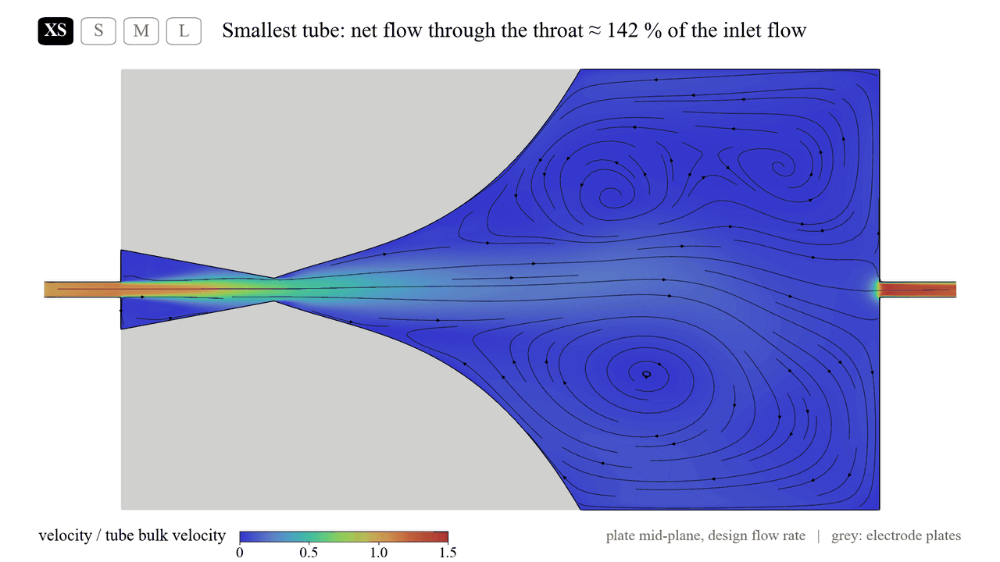
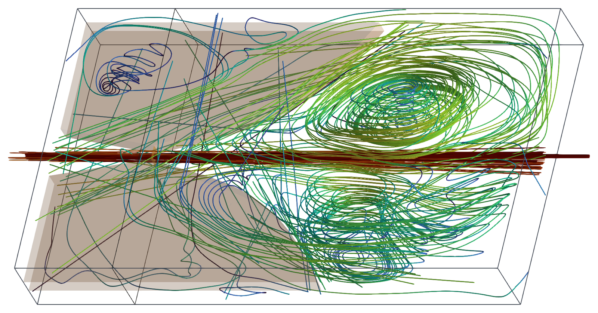
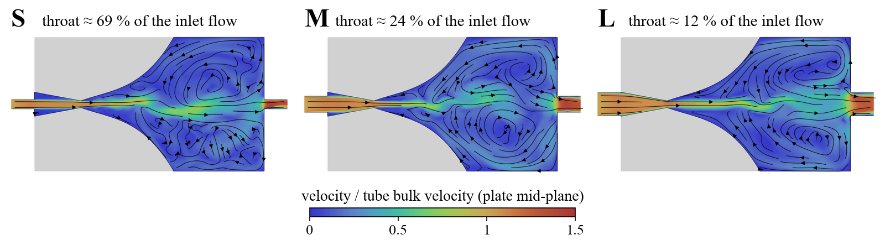
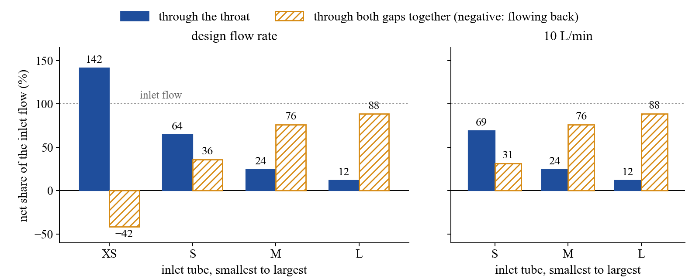
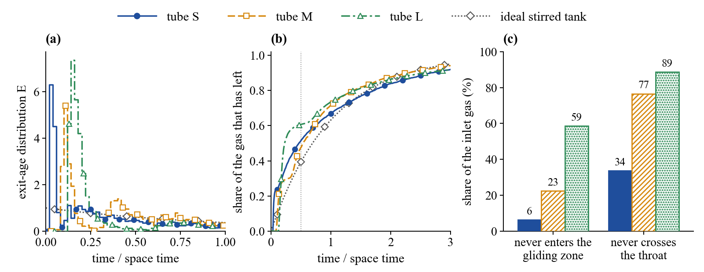
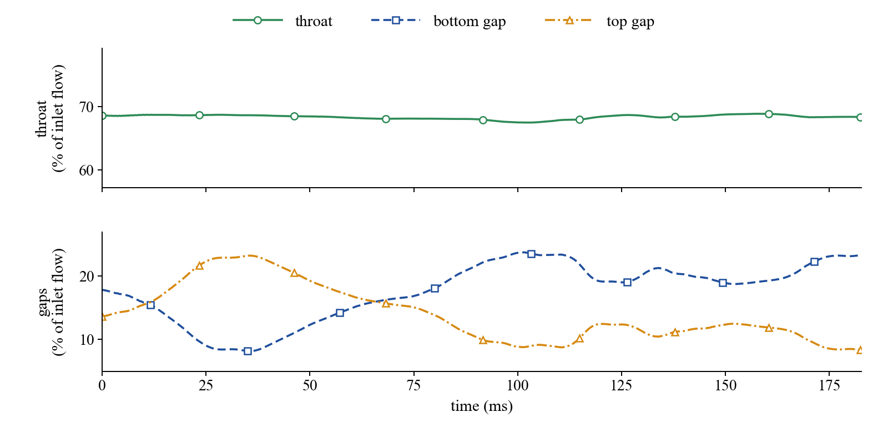

# Gas flow through a gliding-arc reactor

*Cold-flow 3-D CFD of a planar gliding-arc reactor: how much gas passes between the electrodes, and for how long.*

A gliding arc treats only the gas that passes between its electrodes. Here the electrode plates fill only the middle
of the casing depth, so gas can bypass the throat through gaps above and below them. The reactor is from the group
of Asst. Prof. Dr. Necip Berker Üner (METU Chemical Engineering).

## Introduction

<p align="center">
  
  <br><em>Four inlet tubes, smallest (XS) to largest (L), design flow rate: mid-plane velocity over tube bulk velocity. Key frames are steady-solver snapshots; fades are image blends. <a href="media/ga-tube-sizes.mp4">MP4, 1920 × 1080</a></em>
</p>

The arc forms at the throat, where the electrode edges come closest, and glides downstream with the gas. What it
can treat depends on the throat share of the flow and the time gas spends in the gliding zone.

<p align="center">
  
  <br><em>Streamlines, tube XS, design flow rate; colour: velocity, logarithmic.</em>
</p>

## How it fits

- Arc models start from a computed gas flow, since the arc moves with the gas and is cooled by it. This study
  supplies that flow.
- Same audited-CAD and automated OpenFOAM workflow as the
  [Woven wire screen](https://github.com/astralisxx/woven-screen-cfd) study.

## What I did

- **Geometry** rebuilt from the original design model and audited.
- **Steady 3-D CFD in OpenFOAM:** incompressible air, k-omega SST for turbulent jets, laminar otherwise, wall
  resolved at the throat (y+ ≈ 1).
- **Mesh independence** on five levels: throat share changes by at most 1.5 % between levels.
- **A time-resolved run** where the steady iteration does not settle.
- **Particle tracking:** residence time, throat crossings, time in the gliding zone.
- **AI-agent workflow.** I planned the study and made the decisions; Claude agents built the CAD, pipeline, figures
  and report drafts.

<details>
<summary>Definitions</summary>

```
Flow:          div(u) = 0,   (u . grad) u = -grad(p)/rho + div(tau)      (laminar, or k-omega SST)
Split:         f_throat + f_bottom + f_top = 1      (net flows through the throat plane / inlet flow)
Residence:     theta = t/(V/Q),   E(theta) = exit-age distribution,   F(theta) = share of the gas that has left
Stirred tank:  F(theta) = 1 - exp(-theta),   so F(0.5) = 0.39
Exposure:      time a parcel spends in the gliding zone between the diverging electrode edges
```

V/Q is the space time: reactor volume over volumetric flow rate.

</details>

## Results

<p align="center">
  
  <br><em>Flow at 10 L/min on the plate mid-plane, steady-solver snapshots.</em>
</p>

**Wider tubes send most gas around the electrodes.** At 10 L/min the throat takes about 69 % of the flow with tube
S, 24 % with M and 12 % with L.

<p align="center">
  
  <br><em>Net share of the inlet flow through the throat and the gaps; negative: flowing back.</em>
</p>

**With the smallest tube the gaps become return paths.** At the design flow rate the XS jet entrains so much gas
that 142 % of the inlet flow crosses the throat; the excess returns through the gaps.

**Far from a stirred tank.** The jet core runs straight out: 48 % to 61 % of the gas leaves within half the space
time (stirred tank: 39 %).

<p align="center">
  
  <br><em>Particles at 10 L/min: (a, b) residence time distributions; (c) gas never entering the gliding zone or crossing the throat.</em>
</p>

**The gaps also feed the gliding zone.** Gas that never enters it grows from 6 % (S) to 23 % (M) and 59 % (L), far
less than the gas missing the throat.

**Tube S makes the flow unsteady.** Its transitional jet makes the gaps trade flow in anti-phase, each between 8 %
and 24 % of the inlet flow, while the throat share stays between 67 % and 69 %.

<p align="center">
  
  <br><em>Tube S at 10 L/min, time-resolved; equal ranges on both axes.</em>
</p>

## Conclusions

- With wider tubes most gas bypasses the throat through the side gaps.
- At the design flow rate the narrowest tube turns the gaps into return paths.
- A jet core leaves early while recirculation cells hold the rest.
- Tube M is the recommended compromise: steady, unlike S, and over three quarters of its gas enters the gliding
  zone, against two fifths with L.

## Limits

- **Cold flow.** The arc heats the gas and changes the flow.
- **Flat inlet profile.** A developed profile from a longer feed line would change the split.
- **Transitional jet.** Tube S gives a 65 % throat share with k-omega SST, 69 % laminar.
- **Frozen fields.** Laminar residence-time tails are upper bounds; for tube S the field is one snapshot.
- **Short record.** The time-resolved run spans about one gap swing; the period is unresolved.
- **No experiment yet.**

## Related work

Sibling OpenFOAM study: [Woven wire screen](https://github.com/astralisxx/woven-screen-cfd).

<details>
<summary>Gliding-arc models that take the gas flow as input</summary>

- S. Kolev, A. Bogaerts, "A 2D model for a gliding arc discharge", Plasma Sources Sci. Technol. 24 (2015) 015025.
  https://doi.org/10.1088/0963-0252/24/1/015025
- G. Trenchev, S. Kolev, A. Bogaerts, "A 3D model of a reverse vortex flow gliding arc reactor", Plasma Sources
  Sci. Technol. 25 (2016) 035014. https://doi.org/10.1088/0963-0252/25/3/035014
- S. R. Sun, S. Kolev, H. X. Wang, A. Bogaerts, "Coupled gas flow-plasma model for a gliding arc: investigations of
  the back-breakdown phenomenon and its effect on the gliding arc characteristics", Plasma Sources Sci. Technol. 26
  (2017) 015003. https://doi.org/10.1088/0963-0252/26/1/015003
- S. Pellerin, F. Richard, J. Chapelle, J.-M. Cormier, K. Musiol, "Heat string model of bi-dimensional dc Glidarc",
  J. Phys. D: Appl. Phys. 33 (2000) 2407-2419. https://doi.org/10.1088/0022-3727/33/19/311

</details>

## Source and copyright

This repository holds only this page and its media. The CAD scripts, OpenFOAM cases, meshes, pipeline code and
report are private.

Copyright (c) 2026 Ahmet Berkay Şimşek. All rights reserved. The figures and the animation may not be reused
without permission.
